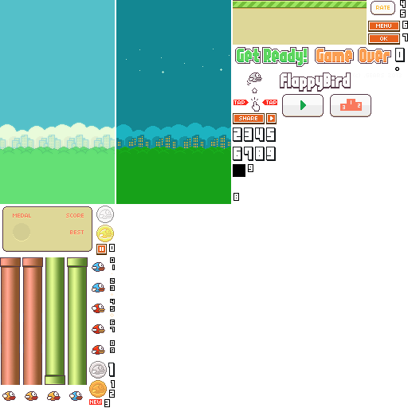
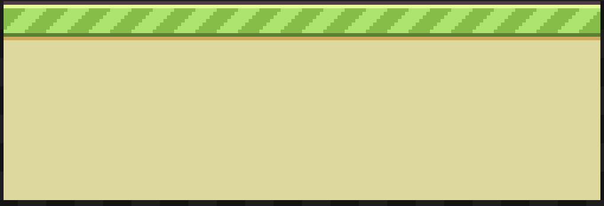
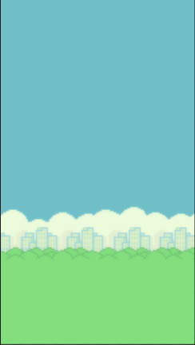
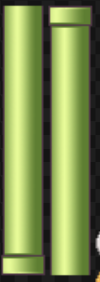
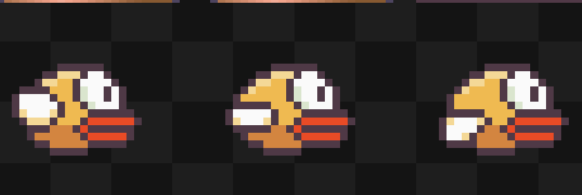

# flappy

## Everything is in myGame folder 

It is a flappy bird game I have made for a guide that i need to show to beginners and explain them about kaplay.js the difference between the original game and this one is that it is made thru kaplay.js which is a framework for javascript to make games in the web and I loved making game with it cause it is really intutive and easy of beginners and one of the biggest reasons to use kaplay was the fact that i was the most comfortable with javascript if we talk about languages . I strongly recomment it to anyone who is trying to get into game dev and needs a path to come in if he only knows javascript 

# inspiration

I started game dev using godot but the thing was it seems to be quite a platform to make games with low code but i wanted something where i can build games with more effort into the code aspect rather than the design aspect and be familiar with the language also 

# Difficulties I faced

The biggest difficulty was that it had very less resources available to learn from but i was very luck it has very informative and cool docs which are easy to scroll thru which makes it one of the most accessible ways thru which anyone can enter into game dev from web dev 

# Spritesheet


**Huge Credits to [superjustinbros](https://www.spriters-resource.com/profile/superjustinbros/)**
The spritesheet was take from [sprites-resource.com](https://www.spriters-resource.com/mobile/flappybird/asset/59894/?__cf_chl_tk=CHTAyZ44ge_mLBa_Wye4xDSzI614UDPwdWYdr9DqC3Q-1795506578-1.0.1.1-8iCttseNBVpa8a08Yhuzqc3Q.5qIXmgXlpKohWM.pMg) and it is one of the best flappy bird spritesheet available out there do check out the work of this guy i liked the assests so much because these are placed really well which makes making a judgement about the positioning and size of the assets really easy which is very important for kaplay because whenever u do that in javascript u need to specify everything as shown below <br>

```javascript
k.add([
    sprite("sprite"),
    pos(x,y),
    width: 23,
    height: 59,
])
```

and how we added everything to thru code is written below 

```javascript

k.loadSpriteAtlas("sprites/flappybird.png",{
    "bg_day":{
        x: 0,
        y: 0,
        width: 144,
        height: 256,
    },
    "bg_night":{
        x: 146,
        y: 0,
        width: 144,
        height: 256,
    },
    "ground":{
        x: 292,
        y: 0,
        width: 144,
        height: 56,
    },
    "pipe_green_top":{
        x:56,
        y:323,
        width: 26,
        height: 160,
    },
    "pipe_green_bottom":{
        x:84,
        y:323,
        width: 26,
        height: 160,
    },
    "bird_yellow":{
        x:0,
        y:483,
        width:84,
        height: 23,
        sliceX: 3,
        anims:{
            "fly":{
                from:0 ,
                to:2,
                loop: true,
                speed: 10,
            }
        }
    },
    "get_ready":{
        x: 295,
        y: 59,
        width: 92,
        height: 25,
    },
    "game_over":{
        x: 395,
        y: 59,
        width: 96,
        height: 25,
    },
    "restart":{
        x: 354,
        y: 118,
        width: 52,
        height: 30,
    }
})
```

# Game Logic 

So basically in this game the logic is in these assets which i will explain all one by one <br>
* ground
* background
* pipes
* bird
<br>

## **Ground**
<hr>


<br>
The basic logic is that we have one ground in the main screen which 144*256 and the width of the ground is the width of the screen but yeah height is small and it moves out of the screen while we have another ground which comes in place of the first ground as it goes out of the screen and the same logic repeats again and again with the same 2 grounds the code below makes that happen. we also have a onUpdate function which keeps them animated at 60 fps

```javascript
ground1.move(-speed,0)
        ground2.move(-speed,0)
        if(ground1.pos.x <= -width()){
             ground1.pos.x = ground2.pos.x + width()
             generatepipe()
        };
        if(ground2.pos.x <= -width()){ 
            ground2.pos.x = ground1.pos.x + width()
            generatepipe()
        };
```
<br>
dont worry about the generatepipe() function we will learn about that afterwards for now we are js moving the ground as per the logic 

## **Background**
<hr>


<br>
The background follows the same logic as of the ground and the code below tells u about it there is only one change that is the speed at which it goes 

```javascript
bg1.move(-speed/4,0)
bg2.move(-speed/4,0)
if(bg1.pos.x <= -width()) bg1.pos.x = bg2.pos.x + width();
if(bg2.pos.x <= -width()) bg2.pos.x = bg1.pos.x + width();
```
## **Pipes**
<hr>


<br>
The pipes are interesting cause the way they have been added are also different but they move the same way so we made an array of pipes in which pipe is added after generating it thru a function called generatepipe() and then removed once it has done it's work . in the generate pipe function what we do is we add a pipe as a sprite the top one then we add the other pipe as a child of the top pipe so that it takes the parent (top) pipe as the one to refer to while positioning with a random gap between them <br><br>
The code below is for the pipes 

**generatepipe()**
```javascript
let pipes = []
const generatepipe = ()=>{
    let y = k.rand(minY,maxY)
    let gap = k.rand(minGap,maxGap)
    const pipe1 = k.add([
        sprite("pipe_green_top"),
        anchor("botleft"),
        pos(width(),y),
        area(),
        body({isStatic : true}),
        "kill"
    ])
    pipe1.add([
        sprite("pipe_green_bottom"),
        pos(0,gap),
        area(),
        body({isStatic: true}),
        "kill"
    ])
    pipe1.add([
        rect(1,gap),
        pos(13,0),
        opacity(0),
        area(),
        "score"
    ])
    pipes.push(pipe1)
    if (pipes.length > 2){
        pipes.shift().destroy();
    }
}
```
**Some more code for pipes**
*This is in the onUpdate() function*
```javascript
pipes.forEach(pipe => {
            pipe.move(-speed,0)
        });
```
<br>

*Some variables*
```javascript
let speed = 50;
let speedIncrement = 0.01;
const minY = 30;
const maxY = 100;
const minGap = 40;
const maxGap = 100;
let isRunning = true;
let score = 0
```

## **Bird**

The Bird is the one that is the main character of the game and that is why it required a bit of work we needed to create a logic for gravity that it goes down than an onClick function so that it jumps when u click and then we also had to change it's angle by keeping it dependant onto the velocity so that as it falls down it faces down . we also needed to add hitboxes to the pipe for the score to be updated whenever it collides with them and also we had to create onCollide function for when it hits any kill zone so that game stops and it shows game over <br>
<br>



**The Code for all of it**
*Code to add bird*
```javascript
const bird = k.add([
    sprite("bird_yellow"),
    pos(width()/4,(height()-56)/2),
    body(),
    area({
        shape: new k.Rect(k.vec2(4,8),14,12)
    })
])
```
*Code to play animation*
```javascript
bird.play("fly")
onClick(()=>{
    bird.jump(70)
})
```
*Code for colliding killzone*
```javascript
bird.onCollide("kill",()=>{
    k.setGravity(0)
    onClick(()=>{
       bird.jump(0.000001)
    })
    onKeyPress("space",()=>{
       bird.jump(0.00001)
    })
    isRunning = false;
    bird.stop("fly")
    add([sprite("game_over"),pos(center()),anchor("center"),z(100)])
})
```
*Code for Scoring*
```javascript
bird.onCollide("score",()=>{
    score++;
    scoretext.text = score
})
```
*Code for bird angle and speed*
```javascript
bird.angle = bird.vel.y / 10;
speed += speedIncrement;
```

### The interesting thing to note is that the bird is only moving in y axis only and gravity is pulling it down and click takes it upwards but it is not moving in the x axis 

<hr>

# Do explore Kaplay.js 


